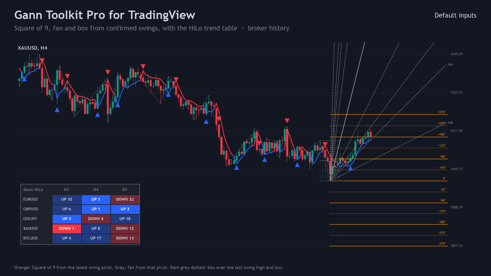
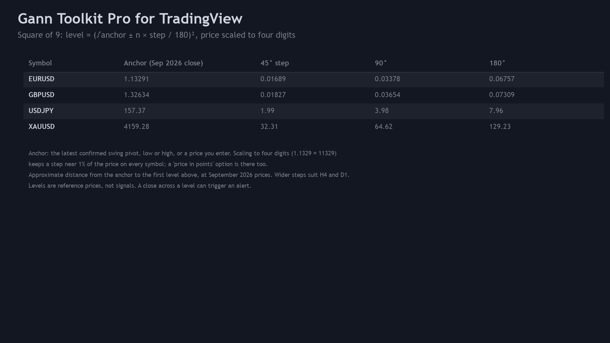
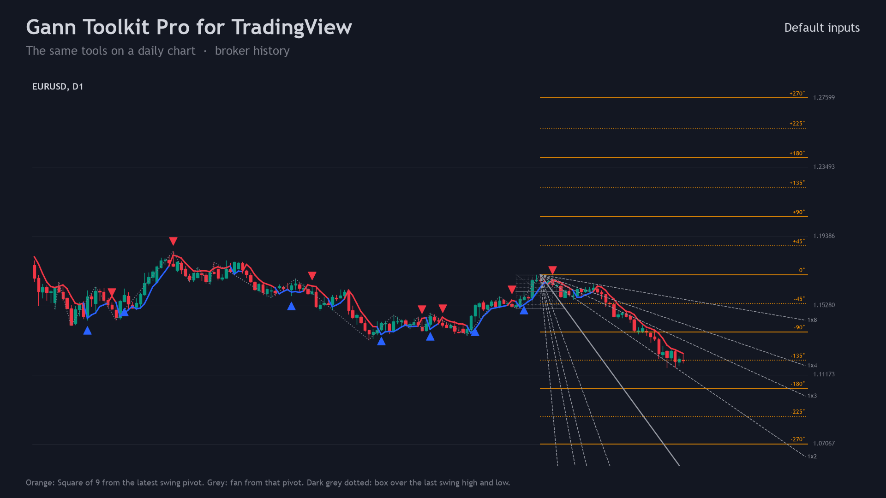
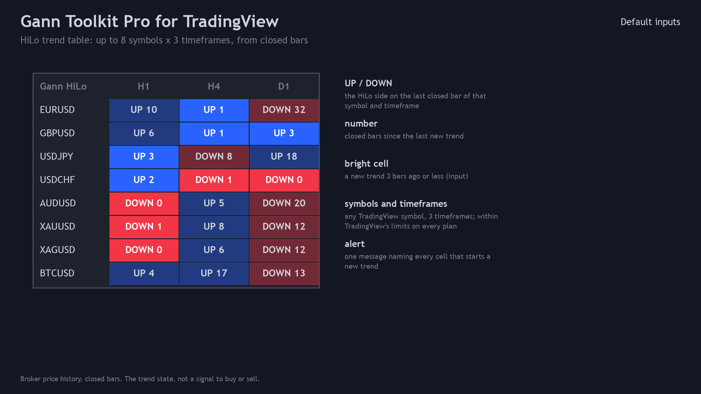
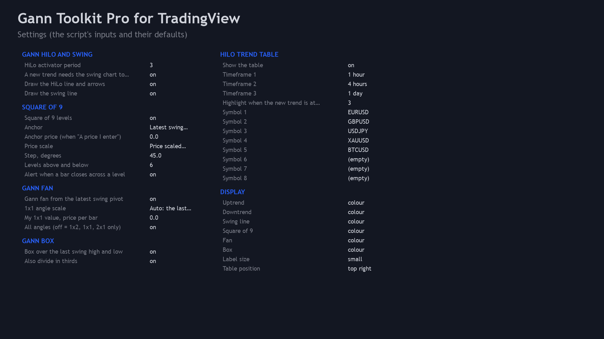
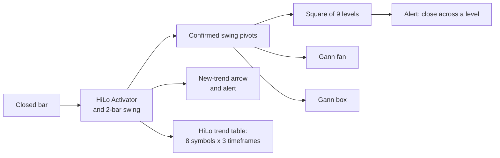

# Gann Toolkit Pro for TradingView (Pine Script v6)

A TradingView indicator with W.D. Gann's price and time tools, anchored to the swings its engine confirms on closed
bars: **Square of 9 levels**, a **Gann fan**, a **Gann box**, the **HiLo Activator** line with its swing line and
new-trend arrows, and a **HiLo trend table** for up to 8 symbols in 3 timeframes. Levels, not signals.

> **This is a showcase repository: documentation and images only. There is no source code here.** Gann Toolkit Pro is a
> paid script, delivered to the buyer as source with a personal-use licence. The free HiLo and swing script it builds on
> has public source: [allanninal/gann-hilo-swing-pine](https://github.com/allanninal/gann-hilo-swing-pine).

**Website:** [allanninal.dev](https://www.allanninal.dev) (product page coming soon) · MetaTrader editions:
[allanninal.dev/mql5 (indicators)](https://www.allanninal.dev/mql5/#indicators)
· **Contact:** message me on [LinkedIn](https://www.linkedin.com/in/allanninal/).

## What it does

- **HiLo Activator and 2-bar swing chart**, as in the free script: the trend line (blue up, red down), a dotted line
  through the confirmed swing highs and lows, and an arrow where a new trend starts.
- **Square of 9 levels** around the latest confirmed swing pivot (low, high, either) or a price you enter:
  `(sqrt(anchor) +/- n x step / 180)^2`, with the price scaled to four digits so a 45-degree step is about 1% of the
  price on any symbol (gold about 32, EURUSD about 0.0169 at September 2026 prices), or in ticks. Step and number of
  levels are inputs.
- **Gann fan** from the latest pivot: 1x8 to 8x1, up from a swing low and down from a swing high, with the 1x1 angle
  moving as fast as the last completed swing did (or your own price per bar).
- **Gann box** over the last swing high and swing low: price in eighths (and thirds), time over twice the swing's length
  in eighths, and the two diagonals.
- **HiLo trend table:** UP or DOWN and the closed bars since the last new trend, for up to 8 symbols (any TradingView
  symbol) in 3 timeframes; recent changes are highlighted.
- **Alerts:** new trend, a close across a Square of 9 level, and one message for new trends in the table.
- **Closed bars only.** Levels, angles and the box move only when a new swing pivot is confirmed on a closed bar; lines,
  arrows, cells and alerts never change after their bar has closed.
- Works on every TradingView plan, including the free Basic plan (it is added from source in the Pine Editor).

| | |
|---|---|
|  |  |
|  |  |

Image notes: the charts and tables are drawn from the script's Python reference on broker price history, which the
script matches bar for bar; the Square of 9, fan and box follow the script's drawing rules on those pivots. They are
illustrations, not TradingView captures.

## How it was tested

Run on the release code, with [PineTS](https://github.com/LuxAlgo/PineTS) (an independent local Pine v6 runtime)
against the script's Python reference, on the latest 5,000 closed bars of EURUSD, GBPJPY, XAUUSD and BTCUSD on M15, H1
and H4 (12 series, broker history):

| Check | Result |
|---|---|
| Compile (TradingView's Pine v6 compiler) | 0 errors, 0 warnings |
| Every plotted value on every bar, 5 input sets (defaults; period 5 without swing confirmation; anchor at the latest low with 90-degree steps and 3 levels; anchor at the latest high with 30-degree steps; a price you enter) | 0 mismatches: 695,391 / 695,373 / 690,622 / 697,366 / 691,010 values, with 7,147 (7,008) new trends, 9,987 pivots and 7,770 / 7,770 / 3,115 / 9,916 / 3,164 level crossings |
| Repaint: re-run on the series cut at 3 points | 0 of 2,195,820 closed-bar values changed |

The values compared: HiLo line, trend, side, new trend, swing direction, every confirmed pivot (price, bar, type), the
Square of 9 anchor and its first level above and below, the level a close crossed, the fan's 1x1 scale and the box's
high and low. Integers exactly, prices to 1e-9 relative (the test runtime rounds stored values to 10 decimals;
TradingView does not). PineTS cannot load other symbols, so the trend table is covered by the compile check and a check
on a TradingView chart rather than by these numbers; the drawn objects themselves are covered by the values they are
built from.

## Honest limits

- **Levels, not signals.** Square of 9 levels, fan angles and the box are reference prices and times. No stop-loss,
  sizing or exit rules are provided or implied. The HiLo and swing rules, traded automatically with stops and targets
  on 37 symbols, did not pass the author's out-of-sample test: **no edge is claimed**.
- **Period 3 reacts fast.** A new trend starts about 56-63 times a month per symbol on H1 and 14-16 on H4 at default
  settings (author's data). Read the table as the trend state.
- **Pivots are confirmed late**, a few bars after the high or low itself; that is what keeps them from repainting.
- **Table limits:** 8 symbols x 3 timeframes keeps within TradingView's limits on every plan. Use timeframes equal to or
  higher than the chart's.
- **Source, not protection.** Pine cannot protect code on the free plan, so the script is delivered as source under a
  personal-use licence. Please do not share or republish it.

## Free vs Pro

| | Free: Gann HiLo Swing | Paid: Gann Toolkit Pro |
|---|---|---|
| HiLo Activator line, swing line, new-trend arrows and alerts | yes | yes |
| Square of 9 levels (latest swing or your price) | no | yes |
| Gann fan, 1x8 to 8x1 | no | yes |
| Gann box, eighths and thirds | no | yes |
| HiLo trend table, up to 8 symbols x 3 timeframes | no | yes |
| Alert when a bar closes across a level | no | yes |
| Closed bars only, no repaint | yes | yes |
| Source | [public repository](https://github.com/allanninal/gann-hilo-swing-pine) | delivered to the buyer |
| Price | free | one-time price, 12 months of updates |

No need to install the free script to use Gann Toolkit Pro: it is standalone.

## Licence

Documentation and images only, all rights reserved: see [`LICENSE`](LICENSE). Trading involves risk; the software is
provided as is.

---

**Website:** [allanninal.dev](https://www.allanninal.dev) · [MetaTrader editions](https://www.allanninal.dev/mql5/#indicators)
· Questions: message me on [LinkedIn](https://www.linkedin.com/in/allanninal/).
